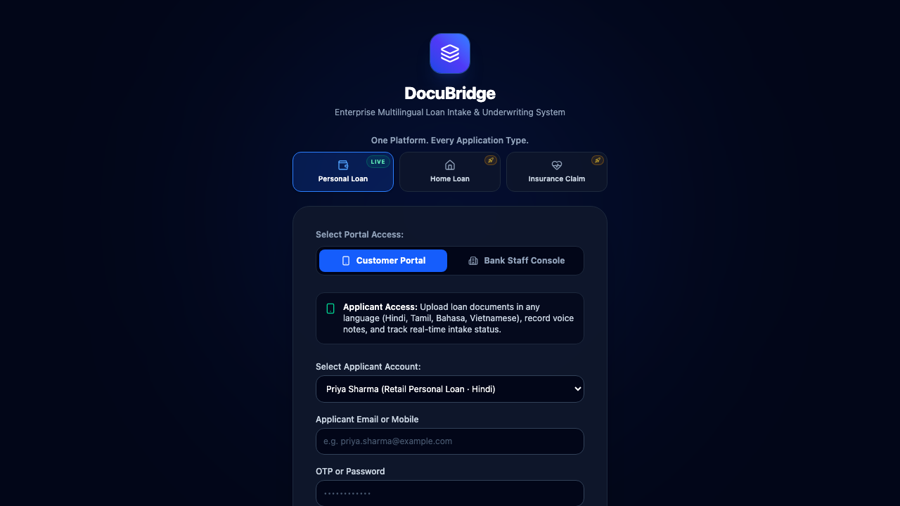
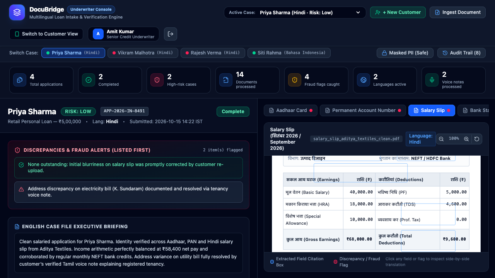
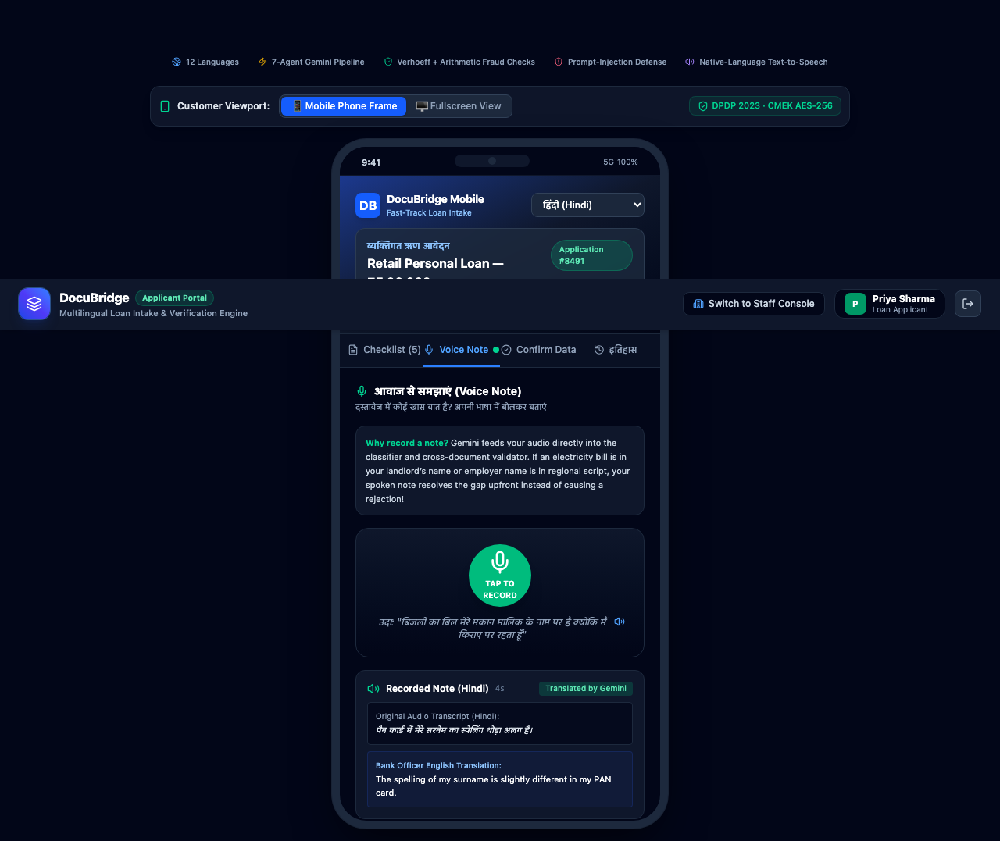
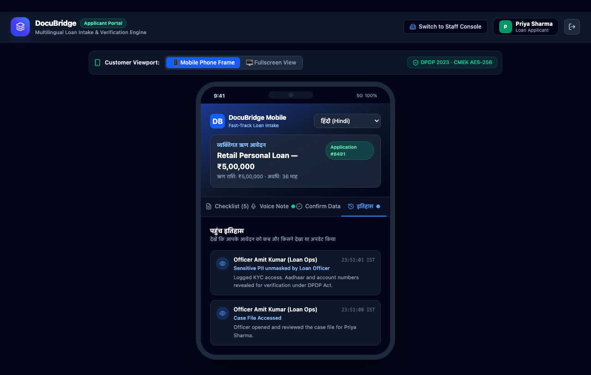
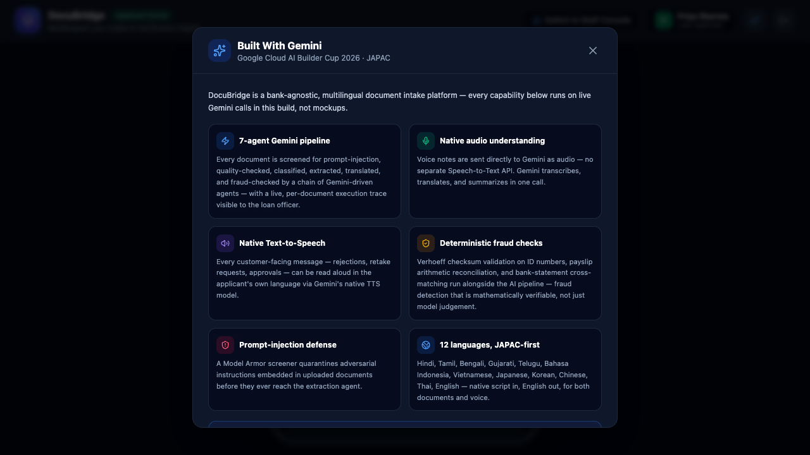

# DocuBridge

**Multilingual Financial Document Intake Platform — powered end-to-end by Gemini**

Built for the [Google Cloud AI Builder Cup 2026](https://aibuildercup.com) (JAPAC) — *Build in JAPAC. Build for the world.*

🔗 **Live demo:** [docubridge.ai.studio](https://docubridge.ai.studio)

---

## The problem

Across JAPAC, financial institutions lose applicants not because of risk, but because of language and document friction. An applicant who speaks Hindi, Thai, Japanese, or Bahasa Indonesia often can't tell *why* a document was rejected. Officers manually cross-check IDs, payslips, and bank statements across a dozen scripts and currencies. And every bank builds its own one-off intake pipeline instead of sharing a battle-tested layer.

## The solution

DocuBridge is a **bank-agnostic intake platform** any lender or insurer can plug into. Every uploaded document runs through a 7-agent Gemini pipeline; every voice note is transcribed and translated by Gemini's native audio understanding; every customer-facing message can be read aloud via Gemini's native Text-to-Speech — serving users who can't read the script.



## Key features

- **7-agent Gemini pipeline** — Model Armor (prompt-injection screening) → Quality → Classifier → Extraction → Translation → Fraud Agent → Summary, with a **live, per-document agent execution trace** visible to the loan officer
- **Real voice notes** — applicants record in their own language; Gemini transcribes, translates, and summarizes directly from audio, no separate Speech-to-Text API
- **Native Text-to-Speech** — any customer-facing message (rejection, retake request, approval) can be read aloud in-language
- **Deterministic fraud detection** — Verhoeff checksum validation on ID numbers, payslip arithmetic reconciliation, bank-statement cross-matching
- **Page-level source citations** — click any extracted field to see its exact bounding box on the original document
- **Customer-visible transparency** — applicants see exactly when an officer opened their file or unmasked sensitive PII
- **12 languages** — Hindi, Tamil, Bengali, Gujarati, Telugu, Bahasa Indonesia, Vietnamese, Japanese, Korean, Chinese (Simplified), Thai, English
- **Multi-product platform** — Personal Loan fully live; Home Loan and Insurance Claim previewed on the same pipeline
- **Portfolio analytics** — real-time stats computed from live case data, not mocked numbers

| Staff Console — fraud alerts, agent trace, analytics | Voice note — real microphone, Gemini transcription |
|---|---|
|  |  |

| Customer-facing access history | Built-With-Gemini panel |
|---|---|
|  |  |

## Google services used

| Capability | Service |
|---|---|
| Document field extraction, bounding-box citations, classification | **Gemini** (multimodal vision) |
| Voice note transcription & translation | **Gemini** (native audio understanding) |
| Spoken customer messages | **Gemini** (native Text-to-Speech) |
| Development | **Google AI Studio** |
| Deployment | **Google Cloud Run** |

## Tech stack

- **Frontend:** React 19, Vite, TailwindCSS, TypeScript
- **Backend:** Node.js, Express, TypeScript
- **AI:** Gemini 3.5 Flash family (vision, native audio), Gemini 2.5 Flash native TTS, with multi-model fallback chains for resilience against rate limits and model deprecation
- **Testing:** Playwright + real Chrome — automated end-to-end verification across every portal, tab, and modal

## Architecture

```
Client (React/Vite)  →  Server (Express/TypeScript)  →  Gemini (multimodal vision, native audio in/out)
Dual portal: Customer / Staff Console     7-agent pipeline orchestration     Deployed on Cloud Run / AI Studio
```

Documents and audio are sent directly as inline multimodal data to Gemini — no separate OCR or Speech-to-Text service required.

## Running locally

```bash
npm install
cp .env.example .env   # add your GEMINI_API_KEY (free — https://aistudio.google.com/apikey)
npm run dev             # http://localhost:3000
```

## Judging-criteria alignment

| Criterion | Weight | How DocuBridge addresses it |
|---|---|---|
| Technical Merit & Gen AI Implementation | 40% | 7-agent Gemini pipeline, native audio in/out, deterministic fraud checks, verified via exhaustive automated testing |
| Problem Alignment & Impact | 25% | Solves real JAPAC financial-inclusion friction — language barriers, manual fraud review, one-off bank builds |
| Innovation & Creativity | 25% | Bank-agnostic platform model, full voice round-trip, customer-facing transparency and trust features |
| UX & Solution Design | 10% | Dual-portal design, accessibility-first (TTS, 12 languages), crash-resilient by design |

---

DocuBridge · Google Cloud AI Builder Cup 2026 · *Build in JAPAC. Build for the world.*
